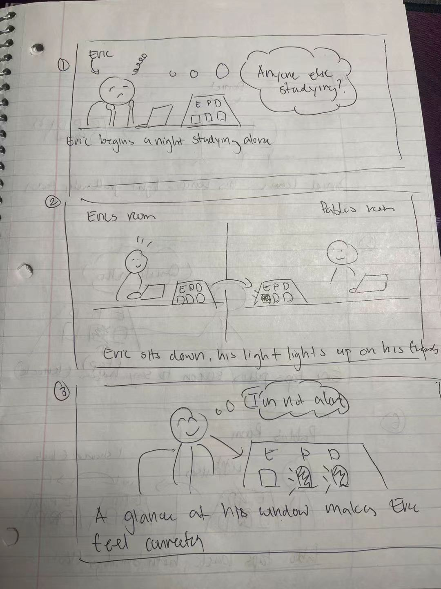
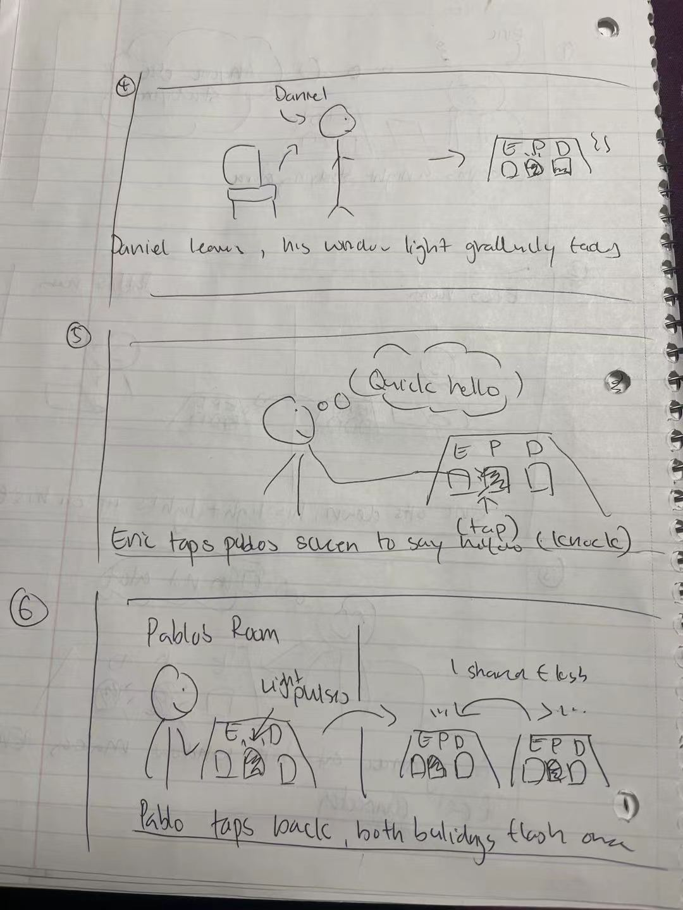
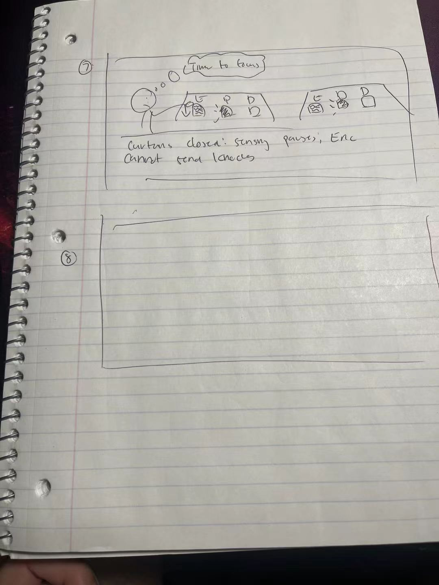

# Final Project Concept: Lit Windows

**Yun-Chung Liu (yl4445) and Hong Yuan Cao (hc2343)** · November 9, 2026

## The idea

Each friend in a group keeps a small paper apartment building on their desk, with one window per person. A window lights up when that friend is at their desk. Late at night you can look over and see who else is still up working, like noticing whose lights are on across a courtyard.

## Why

- During finals my friends and I study in separate dorms. Knowing others are working too helps, but texting "still up?" interrupts people, and a six-hour video call is too much.
- Lit windows are a cue people already understand: you can tell someone is home without them doing anything.

**Who:** 3 to 5 friends who all agree to share their desk presence.
**Where:** desks in dorms and apartments, mostly late at night.
**Also present:** roommates, who never agreed, so the sensor only watches the owner's chair.

## How it works

- **Being there:** a sensor notices when I'm in my chair. My window glows on every friend's building. When I leave, it fades over about ten minutes, so "just left" looks different from "gone for the night."
- **Knocking:** tap a friend's window and your picture appears in your window on their building, like seeing someone at the window. If they tap back, their picture appears on yours. No text, no notifications. The pictures are photos each person picks ahead of time, not live camera images.
- **Curtain:** pulling a paper curtain down over my window means "I'm here, but don't knock." Friends see a dim, curtained window.
- **Morning (maybe):** a row of tiny lights along the bottom shows when each window was lit overnight.

## Storyboard

1. Eric begins a night studying alone and wonders if anyone else is studying.
2. Eric sits down, and his window lights up on his friends' buildings.
3. A glance at his building shows Pablo's and Daniel's windows lit, and Eric feels connected.

4. Daniel leaves his chair, and his window light gradually fades.
5. Eric taps Pablo's window to say a quick hello (a knock).
6. In Pablo's room, Eric's picture appears in his window. Pablo taps back, and Pablo's picture appears on Eric's building.

7. Time to focus: Eric closes his curtain. Sensing pauses, and Eric can't send knocks.

## What it builds on

- **Lab 1 (Pulse Room):** light as the medium, your presence shown beside others', and seeing someone leave instead of them just vanishing.
- **Lab 2 (sun and moon clock):** an ambient display you read at a glance, without numbers.
- **Lab 3 (Mini Judge):** clear state cues, so a knock shows "sent" and "knocked back" instead of feeling frozen.
- **Lab 4 (Fly Shoo):** one physical action, one clear response, with the control where your hand already is.
- **Lab 5 (Desk Curfew):** watch the chair, not the person; save no images; "away" only means nobody was detected.
- **Lab 6 (Mouse Game):** several Pis over MQTT, from our desk presence board idea. Presence can lag a little, but a knock has to feel instant.

## Open design questions

- **Roommates and privacy:** a chair switch or proximity sensor may be better than a camera, since it can't see anyone else.
- **What a dark window means:** asleep, at the library, or broken? Show only what's known, with a separate "offline" flicker.
- **Surveillance:** could the morning history make friends feel judged or push people to stay up later? Maybe it should be opt-in or private.
- **Fairness:** if I can see you, you can see me. Closing my curtain should also stop me from knocking.
- **Readability:** windows need to read from across the room while staying dim enough for 2 AM.

## Other scenarios

- **Long-distance partners:** show a night sky behind their window when it's night where they are.
- **A grandparent living alone:** a dark window at noon means something very different.
- **A shared lab:** one building showing whose bench is occupied.

## Rough build and test

- **Each person:** a Raspberry Pi, a chair presence sensor, a capacitive pad per window, a curtain switch, LEDs behind paper windows, and a small screen behind each window to show pictures, all in a cardboard building.
- **Shared:** the course MQTT broker, with topics for presence, knocks, curtain, and online status.
- **Test:** start with two buildings in two rooms for one evening. Check whether the fade reads as "just left" and whether knocks feel immediate. Then run the whole group for a few nights and ask whether it felt less lonely or more watched.

## Alternatives considered

- **Roommate Court across rooms:** fun, but mostly a speech-recognition problem.
- **Pulse Room on the last train:** my favorite emotionally, but hard to test with real strangers.
- **Desk Curfew between friends:** folded in as an open question, since it leans toward judging people.

## Project Plan

### 1. Team and project name

**Lit Windows**, by Yun-Chung Liu (yl4445) and Hong Yuan Cao (hc2343).

### 2. Who works on what

Each of us builds one complete building, so both of us do hardware, code, and documentation. The split is by feature, not by "tech person" and "writing person."

| | Yun-Chung | Hong |
|---|---|---|
| **Hardware** | Chair presence sensor; LED wiring behind the windows | Capacitive knock pads; picture screens behind the windows; curtain switch |
| **Software** | Presence detection and the ten-minute fade; MQTT topics and message format | Knock and knock-back logic; showing the knocker's picture; curtain state; "offline" flicker |
| **Building** | Building #1 | Building #2 |
| **Testing** | Plan the two-room evening test | Run the multi-night group test and interviews |
| **Documentation** | Write up presence, fade, and MQTT design | Write up knocking, curtain, and test findings |

**Together:** the cardboard building design, integration sessions where both buildings talk to each other, the demo video, and a final edit of the whole write-up. We each review the other's code and writing before it's merged.

### 3. The big idea

A small paper apartment building on each friend's desk, with one window per person. Your window lights up on everyone's building when you're at your desk, fades when you leave, and can be curtained off. Tapping a friend's window "knocks," and your picture appears in your window on their building. It lets friends studying late in separate rooms feel each other's presence without texting or video calls.

### 4. Timeline

| Week of | Goal |
|---|---|
| **Nov 9** | Finalize concept and plan; agree on MQTT topics; list and order parts |
| **Nov 16** | One window lights from an MQTT message; a picture shows on a screen; first chair sensor and knock pad readings on the Pi |
| **Nov 23** | Presence and fade working on Building #1; knock-to-picture and curtain working on Building #2 |
| **Nov 30** | Both buildings fully built and talking to each other; two-room evening test; fix what it showed |
| **Dec 7** | Short group test with friends; record the demo video; finish documentation |
| **Dec 8** | **Final demo and submission** |

### 5. Parts to acquire

- 2 Raspberry Pis (we have these from the course kit)
- Chair presence sensor per person: a force-sensitive resistor under the seat cushion, or a proximity sensor aimed at the chair
- MPR121 capacitive touch sensor and copper tape for the knock pads (kit)
- Small color screens to show pictures behind the windows (e.g. the kit's MiniPiTFT, or small SPI LCDs if we need one per window)
- Small micro switch for each curtain
- Addressable LED strip (WS2812 / NeoPixel) or individual LEDs, plus resistors and jumper wires
- Cardboard, tracing paper or vellum for the windows, fabric or paper for curtains
- Power supplies for both Pis and LEDs

### 6. Fall-back plan

- **Chair sensor is unreliable:** swap it for a desk-lamp-style toggle switch you flip when you sit down, so the rest of the system still works.
- **Knocking feels laggy over MQTT:** keep the pictures stored on each Pi ahead of time so a knock only sends a short message, not an image. Show the knock locally right away and confirm when it arrives.
- **One screen per window is too many:** use one shared screen in the building's front door that shows whoever knocked, or fall back to the window blinking twice.
- **Two full buildings take too long:** build one complete building and simulate the other friends' windows from a laptop script publishing to MQTT.
- **Running low on time:** cut the morning history row first, then the curtain, keeping presence and knocking as the core.
