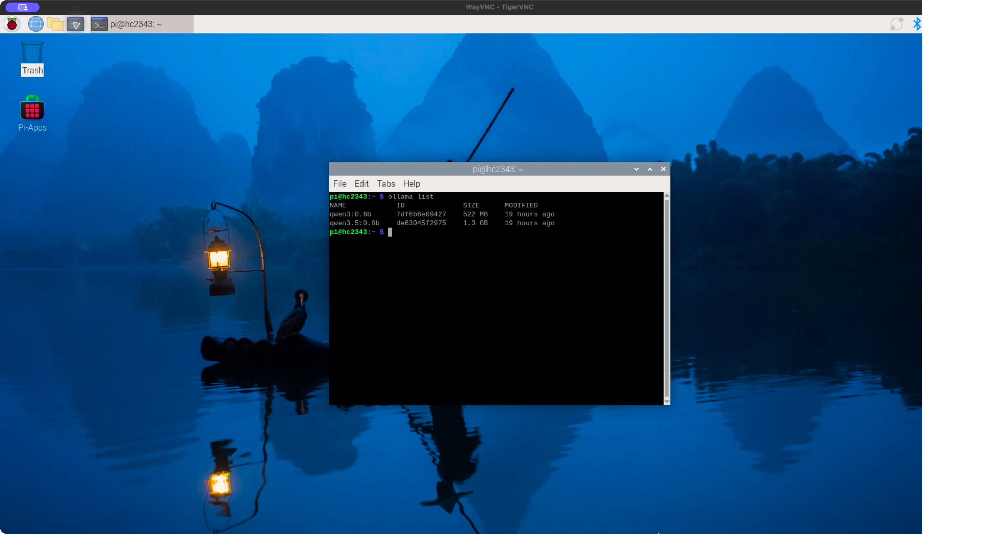
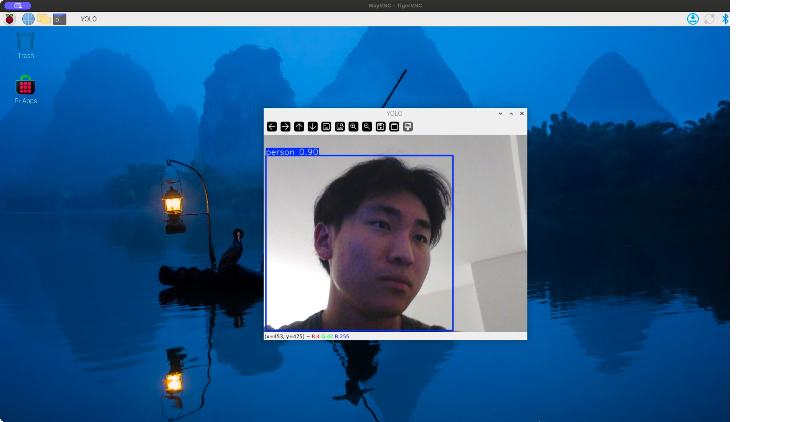
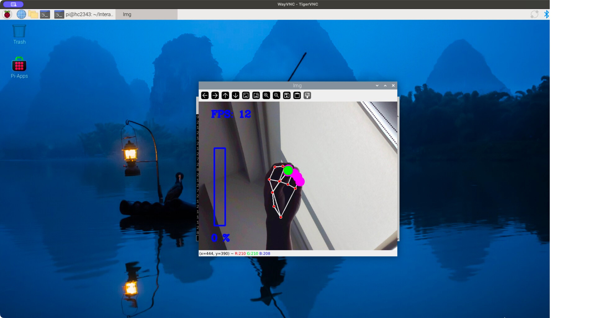
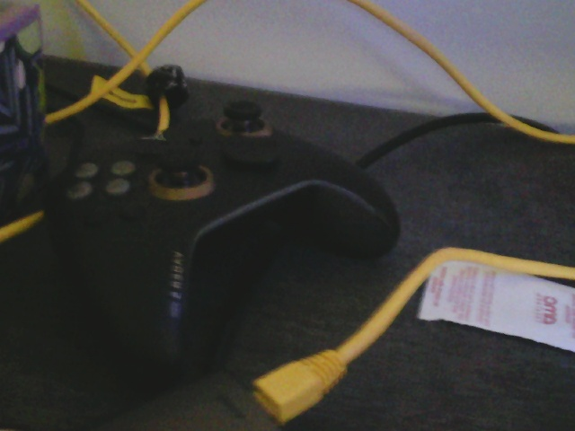

# Observant Systems: Overnight Sensation

**Members:** Hong Yuan Cao (hc2343), Yun-Chung Liu (yl4445)

# Part 1

The Part 1 tests ran on a Raspberry Pi 5 with a USB webcam, using the lab's provided scripts.

## Part A.
### Set up your Pi for on-device AI

The Python dependencies are installed in `.venv`, and the YOLO26 nano model was exported to NCNN and tested. The webcam photo from this part is also used in Part D.

The `ollama list` output on the Pi confirms that both models are installed: `qwen3:0.6b` (522 MB) and `qwen3.5:0.8b` (1.3 GB).

[](evidence/part-a-ollama-list.jpg)

## Part B.
### See: recognize people in real time with YOLO

The USB webcam and `yolo_person.py` ran on the Raspberry Pi, with the live window viewed through VNC. The script uses the NCNN export of YOLO26 nano and a default confidence threshold of 0.4. The screenshot below shows one person detected with confidence 0.90.



## Part C.
### See more: hands and pose with MediaPipe

I ran `hand_pose.py` on the Pi and tested the gestures through VNC. Changing the distance between my thumb and index finger changed the displayed percentage, and Quiet Coyote displayed the gesture label and set the percentage to 0%. The screenshot shows the tracked hand landmarks during a pinch at 0%.



For my nighttime system, I could use body pose tracking to estimate how often I turn over or change position while sleeping. The Pi could log major position changes with timestamps and show a count and timeline in the morning. I would need to test how reliably it tracks movement in low light and when blankets cover the body.

## Part D.
### Reason: run Qwen on the Pi with Ollama

<details open>
<summary>Questions, recorded answers, timings, and comparison — October 25, 2026</summary>

These tests ran on the Raspberry Pi using the provided `ask_qwen.py`, with thinking off, temperature 0.3, and the default 120-token limit. The answers below are copied exactly from the output, including mistakes. Times are the script's elapsed request times, including any model loading and image processing; each is one observation, not an average. None of these answers hit the token limit. [Raw results and run metadata](evidence/part-d-20261025/results.json) are saved with the individual terminal outputs.

**Question 1 — history**

Prompt: `Tell me a bit about the history of Roosevelt Island.`

Model: `qwen3.5:0.8b`. Time: **30.4 seconds**.

> Roosevelt Island was originally built as a private residence for President William McKinley, who named it after himself. The island's history is largely tied to the 1920s and 30s when it became a popular summer resort for wealthy New Yorkers seeking escape from the city's heat.

This answer invents a history and includes none of the lab's four reference facts: Blackwell's Island, then Welfare Island, the Roosevelt Island name in 1973, and Cornell Tech's campus opening in 2017. The [National Park Service's history](https://www.nps.gov/places/blackwell-s-island-new-york-city.htm) documents the earlier names, the city's purchase in 1828, its prison and hospital uses, and the 1973 naming for Franklin D. Roosevelt. [Cornell Tech dates its campus opening to 2017](https://tech.cornell.edu/news/et-custom-timeline/cornell-tech-campus-opens-on-roosevelt-island/).

**Question 2 — reasoning from a supplied log**

Prompt: `A sample movement log contains events at 01:00, 01:15, and 03:00 on the same night. How many events are listed, and what is the longest gap between consecutive events? Use only this log.`

This is hypothetical test data, not a recorded night of sleep.

Model: `qwen3.5:0.8b`. Time: **7.7 seconds**.

> The log lists three distinct events occurring at 01:00, 01:15, and 03:00. The longest gap between these events is 2 hours (from 01:15 to 03:00).

The event count is correct, and it selects the correct pair of times, but the interval is wrong: 01:15 to 03:00 is **1 hour 45 minutes**. For the nighttime system, counts and durations should be calculated in code before the language model summarizes them.

**Question 3 — describing the Part A photo**

Prompt: `What is in this photo?`, using `--image snap.jpg`.

Model: `qwen3.5:0.8b`. Time: **30.5 seconds**.

> A black gaming controller with yellow cables and a USB hub plugged into it.



The black controller and yellow cables are visible. The claim about a USB hub being plugged into the controller is not clearly supported by the photo. This is a useful rough description, but its claimed connections should not be treated as established facts.

**Repeat of Question 1 — smaller model**

Prompt: `Tell me a bit about the history of Roosevelt Island.`

Model: `qwen3:0.6b`. Time: **12.3 seconds**.

> Roosevelt Island was established in 1910 as a temporary refuge for the U.S. Navy during World War I. It became a significant location for military and civilian use, with the island serving as a base for the U.S. Army and Navy. After the war, it became a peaceful community, attracting people from all over the world. Today, it remains a popular destination for visitors and a symbol of peace and freedom.

The smaller model also includes none of the four reference facts, and its Navy-refuge story does not match the documented history linked above. It also gives four sentences despite the script asking for at most three. It was about **2.5 times faster** on this repeated prompt (12.3 versus 30.4 seconds), but neither history answer was reliable. These single end-to-end timings include loading effects, so they do not establish a general speed ratio. The supplied-log test was more constrained, yet still contained an arithmetic mistake; a confident answer is not enough to trust the device's conclusions.

</details>

## Part E.
### Connect: from YOLO readings to Qwen reasoning

### Recorded rerun — October 25, 2026

The pipeline ran on the Pi over SSH with `python yolo_to_qwen.py --headless --seconds 60`. This second run completed successfully, saved **14 changed readings**, and sent the log to `qwen3.5:0.8b` with thinking off. Qwen's response took **16.2 seconds**.

I was the only person in view. I entered, waved at the camera, moved closer and farther away, left the frame, and came back. These are my observations, rather than actions inferred from the detector log.

Evidence: [complete detector log](evidence/part-e-20261025-run2/watch_log.txt), [terminal output and Qwen's answer](evidence/part-e-20261025-run2/terminal-output.txt), [run metadata](evidence/part-e-20261025-run2/run.json), and [reported observations](evidence/part-e-20261025-run2/user-observations.json). The [first run's log](evidence/part-e-20261025-run1/watch_log.txt) and [output](evidence/part-e-20261025-run1/terminal-output.txt) are also preserved; the analysis below uses the rerun.

| Reading | Entries in the change log |
|---|---:|
| `nobody` | 5 |
| `1 person(s) at right/far` | 1 |
| `1 person(s) at center/close` | 5 |
| `1 person(s) at left/close` | 3 |

These are counts of logged changes, not counts of frames, visits, or seconds. At most one person was detected at a time. In this script, `close` means the person's bounding box is taller than 60% of the frame; it is not a measured physical distance.

The default question was: **How many people were there, what were they doing, and did anything change?**

Qwen's exact answer:

> There were 3 distinct individuals identified throughout the 60-second observation: one person was located at right/far, another at center/close, and a third at left/close. No significant changes occurred to their location or activity during this period.

The summary is wrong about both identity and change. I was one person moving through different positions, but Qwen treated the three position labels as three distinct individuals. The detector does not track identity, so the log alone cannot establish a count of unique visitors. Its "No significant changes" claim also contradicts the sequence from `nobody` to `right/far`, then `center/close` and `left/close`, with further presence changes.

My reported entry, exit, return, and distance changes broadly agree with the kinds of changes in the log, but I did not record timestamps for each action, so individual `nobody` entries cannot be assigned confidently to actual exits versus missed detections. A `nobody` reading only means the detector did not find a person in that sample. Waving is not encoded by this interpreter at all: Qwen receives only coarse position and presence labels, so it cannot identify that gesture from this log.

This run shows that getting the whole pipeline to execute does not guarantee an accurate summary. The interpreter limits what the model can know, and the model can still ignore changes that are explicitly present in its input. For an overnight system, counts and durations should be calculated directly from the log, and uncertain detections should remain uncertain in the report.

---

<details>
<summary>Part 2 instructions — to be completed</summary>

# Lab 5 Part 2: Overnight Sensation

For Part 2, you will use the observant system from Part 1 to design a night-time interaction. On-device AI is slow, so let it work while you sleep. The person meets the device twice: **before bed**, when they hand the night over, and **when awake**, when the device gives something back. In between, the pipeline from Part E runs on its own.

Two flavors, pick one or mix them:

* **Sense all night.** The Pi watches, listens or measures from bedtime until morning and keeps a log.
* **Process all night.** You already have the data (a day of phone photos, a long recording) and the Pi needs hours to get through it.

Two house rules. Sample rather than stream: one look every 5 to 30 seconds is plenty, and it keeps the Pi cool. And keep everything on the Pi: tell the people you live with, point the camera at things rather than at beds, and delete the snapshots after the demo.

## Part F. 
### Read Part 2 and storyboard your night-time interaction

Storyboard a night-time interaction built on your observant system, in three panels:

1. **Before bed.** How does the person hand the night over, and how does the device acknowledge it?
2. **While asleep.** What does the device watch or work through?
3. **When awake.** What is the one thing the person learns, and in what medium?

Stuck? A kitchen that tells you who raided the fridge. A desk that reports whether you actually went to bed. A window that names the quietest hour. A plant that describes its night. Find something better.

Use storyboards and/or [Verplank diagrams](https://ccrma.stanford.edu/courses/250a-fall-2004/IDSketchbok.pdf).

\*\*\***Insert ideas, sketches, Verplank diagrams and storyboards for your night-time interaction here.**\*\*\*

## Prep for Part 2

1. Look at and give feedback on the Part F storyboards.
   **Put the feedback for your ideas here.**
2. [Update your Lab Hub](prep.md#get-the-latest-content) to get the latest content for Part 2.
3. Decide where the device will spend the night and who else lives there. Get their OK before the first run.
4. Revise your storyboard with the feedback and with what you learned in Part E about where the pipeline breaks.

\*\*\***Post your revised storyboard here.**\*\*\*

## Part G. 
### Design the interaction before

The hand-off: the person tells the device what to watch tonight, and the device acknowledges it. Keep it to a thirty-second ritual. A button or a touch (Lab 4), a spoken sentence (Lab 3), a wave or a Quiet Coyote at the camera (Part C). The acknowledgement can be a line on the display, a tone, or an LED that dims rather than lights up. At its simplest, the hand-off just sets the question that the morning will answer.

\*\*\***Describe the interaction before.**\*\*\*

## Part H. 
### Incorporate the observant system

The Part E pipeline becomes the night shift. `overnight.py` runs your `interpret()` from `yolo_to_qwen.py` every few seconds, people only unless you pass `--all`, and writes the readings to `night_log.jsonl`; the reasoning waits for the morning. Start it inside `tmux` so it keeps running after you close your laptop, and stop it with Ctrl-C in the morning:

```
(.venv) pi@raspberrypi:~/Interactive-Lab-Hub/Lab 5 $ tmux new -s night
(.venv) pi@raspberrypi:~/Interactive-Lab-Hub/Lab 5 $ python overnight.py
```

Fake a night first: run it for thirty seconds while you walk around, stop it, and run `morning.py` from Part I. When that looks right, run a real night. If your storyboard needs a sensor rather than the camera, swap in the Lab 4 example code and log its reading the same way.

\*\*\***Screenshots or videos of the running system.**\*\*\*

## Part I. 
### Design the interaction after

The reveal. The night produced a log; the morning turns it into something a half-awake person can take in. `morning.py` is the smallest version: it asks Qwen for a three-sentence report.

```
(.venv) pi@raspberrypi:~/Interactive-Lab-Hub/Lab 5 $ python morning.py
```

Make it yours: show the report on the Mini PiTFT, read it aloud with Piper from Lab 3, plot the night as a timeline, or ask for JSON (`--json`, Part D) and move a servo. Whatever you pick, make sure it is honest about a night in which nothing happened.

## Final documentation

Document all the prototypes and iterations you have designed and worked on. The deliverables for this lab are writings, sketches, photos, and videos that show what your system:

* "Looks like": how the device sits in the room at night, and what it looks like at bedtime and in the morning.
* "Works like": the pipeline from detector to interpreter to log to reasoner, with a real night's data.
* "Acts like": how a person hands the night over and what they get back.

\*\*\***Include a short video of the whole system**\*\*\*

As always, make sure you document contributions and ideas from others (and AI) explicitly in your writeup.

You are permitted (but not required) to work in groups and share a turn in; you are expected to make equal contribution on any group work you do, and N people's group project should look like N times the work of a single person's lab. Make sure the page for the group turn in is linked to your personal Interactive Lab Hub page.

## Deliverables & Submission for Lab 5

For submission, the readme.md page for this lab should be edited to include the work you have done:
* Upload any materials that explain what you did, including your code and night log, into your Lab 5 repository, and link them in your Lab 5 readme.md.
* Labs are due on Sundays, make sure to submit your Lab 5 readme.md to Canvas.

<details>
  <summary><strong>Submission Cleanup Reminder (Click to Expand)</strong></summary>

  **Before submitting your README.md:**
  - This readme.md file has a lot of extra text for guidance.
  - Remove all instructional text and example prompts from this file.
  - You may either delete these sections or use the toggle/hide feature in VS Code to collapse them for a cleaner look.
  - Your final submission should be neat, focused on your own work, and easy to read for grading.
</details>

</details>
